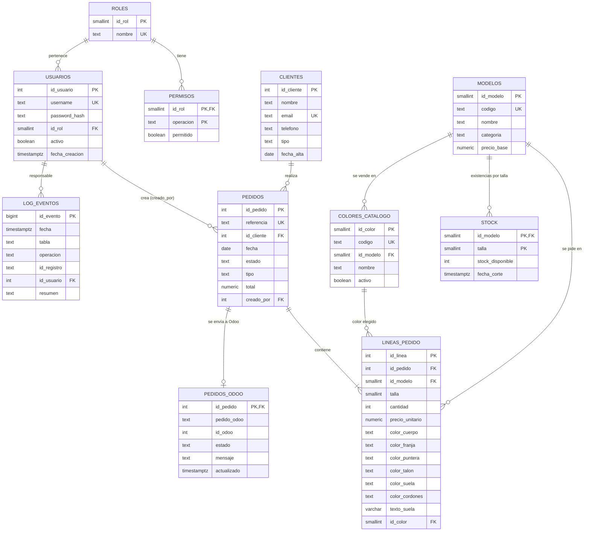

# 01 · Diseño: diagrama entidad-relación

El diagrama está en Mermaid: GitHub y VS Code lo dibujan solos.

## Tablas y relaciones
| Tabla | Para qué sirve |
|---|---|
| `clientes` | Particulares, clubes y equipos. |
| `modelos` | Catálogo: los 6 modelos de la web (mismo `codigo`, nombre y precio). |
| `pedidos` | Cabecera: cliente, fecha, estado, tipo y total (derivados por trigger). |
| `lineas_pedido` | Una línea = modelo + talla + cantidad + personalización (6 partes de color + texto). |
| `stock` | Existencias por modelo y talla (PK compuesta). |
| `roles`, `permisos`, `usuarios` | Seguridad: roles funcionales de la app y matriz de permisos. |
| `log_eventos` | Auditoría de altas, modificaciones y bajas de pedidos y líneas. |
| `colores_catalogo` | Los 3 colores ya hechos de cada modelo que se pueden comprar desde la ficha de producto. |
| `pedidos_odoo` | Qué pedidos se han enviado a Odoo, con qué número (S000xx) y si dio error. |

## Decisiones de diseño (justificación)
1. **Cabecera + líneas**: un pedido tiene varias tallas (SO003 = 9 líneas). Evita repetir cliente y fecha.
2. **Personalización en la línea, no en el pedido**: cada línea puede tener colores distintos. Regla CHECK: o las 6 partes son NULL (estándar) o las 6 están definidas (Custom).
3. **`tipo` y `total` son derivados**: los mantienen triggers; no se escriben a mano → sin totales incoherentes.
4. **`referencia` generada** (`SO` + id con ceros): es la clave de correspondencia con Odoo y PSP.
5. **Dominios `talla_t` y `color_t`**: los mismos valores que el configurador web (tallas 38-46, 8 colores).
6. **Sin `ON DELETE CASCADE`**: un borrado nunca arrastra datos por accidente; para borrar un pedido hay que borrar antes sus líneas.
7. **Clave de duplicidad documentada**: índice único (pedido, modelo, talla, personalización, texto).
8. **Stock por (modelo, talla)** con `CHECK (stock_disponible >= 0)` como red de seguridad además del trigger.
9. **Precio copiado a la línea** (`precio_unitario`): si cambia el catálogo, los pedidos antiguos no cambian.
10. **Eliminación lógica**: un pedido no se borra de la historia, pasa a `cancelado` (queda auditado). El DELETE físico solo existe para el Administrador y solo sobre pedidos pendientes.
