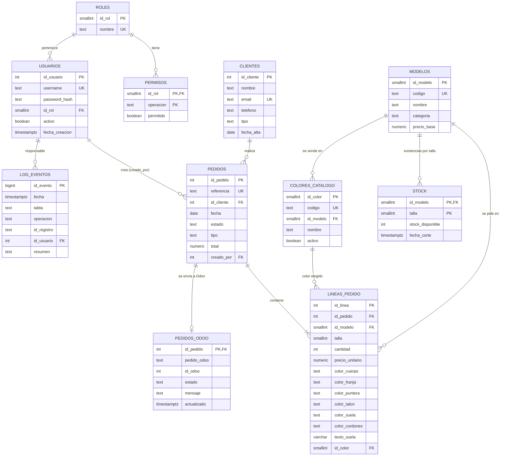

# 01 · Diseño: diagrama entidad-relación

El diagrama está hecho con Mermaid: al abrir este fichero en GitHub o en VS Code se ve dibujado.

## Tablas
| Tabla | Para qué sirve |
|---|---|
| `clientes` | Particulares, clubes y equipos. |
| `modelos` | Los 6 modelos de la web, con el mismo código, nombre y precio. |
| `pedidos` | La cabecera del pedido: cliente, fecha, estado, tipo y total. |
| `lineas_pedido` | Cada línea es un modelo en una talla, con su cantidad y, si es Custom, sus 6 colores y el texto. |
| `stock` | Cuántos pares hay de cada modelo en cada talla. |
| `roles`, `permisos`, `usuarios` | Los usuarios de la aplicación, su rol y qué puede hacer cada rol. |
| `log_eventos` | La auditoría: quién creó, cambió o borró cada pedido y cuándo. |
| `colores_catalogo` | Las 3 combinaciones de color que se venden de cada modelo. |
| `pedidos_odoo` | Qué pedido de Odoo corresponde a cada uno y si el envío dio error. |

## Por qué está diseñada así
1. **Cabecera y líneas.** Un pedido tiene varias tallas (SO003 tiene 9 líneas). Así el cliente y la fecha no se
   repiten en cada línea.
2. **Los colores van en la línea.** Cada talla podría llevar colores distintos. Una regla obliga a que estén los 6
   colores o ninguno.
3. **El total y el tipo los calcula la base.** Los triggers los recalculan cada vez que cambian las líneas, así nunca
   hay un total que no cuadre.
4. **La referencia se genera sola** (SO + el número con ceros). Es la que une el pedido con Odoo y con Java.
5. **Tallas y colores con valores fijos.** Solo se admiten las tallas 38 a 46 y los 8 colores del configurador.
6. **No hay borrado en cascada.** Borrar un pedido nunca arrastra datos por accidente: primero hay que borrar sus líneas.
7. **No se repiten líneas.** No puede haber dos líneas iguales (mismo pedido, modelo, talla y colores).
8. **El stock nunca baja de cero.** Lo impide una regla de la tabla, además del trigger.
9. **El precio se guarda en la línea.** Si mañana cambia el precio del catálogo, los pedidos antiguos no cambian.
10. **Los pedidos se cancelan, no se borran.** Así queda la historia en la auditoría. Borrar de verdad solo puede el
    administrador y solo pedidos pendientes.
